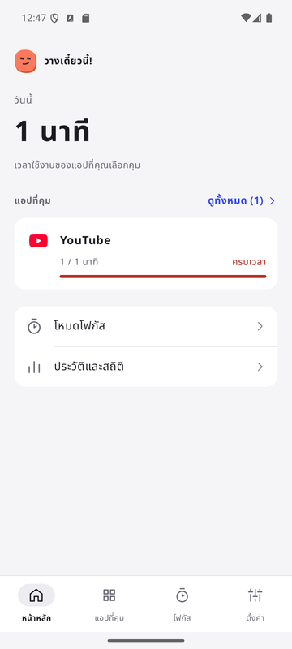
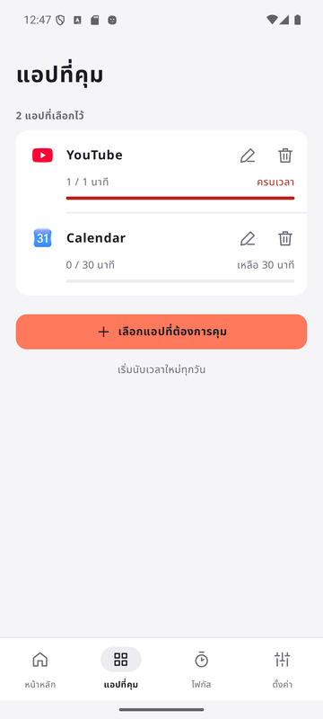
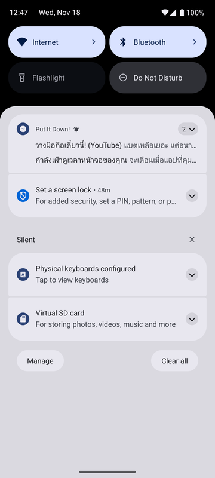
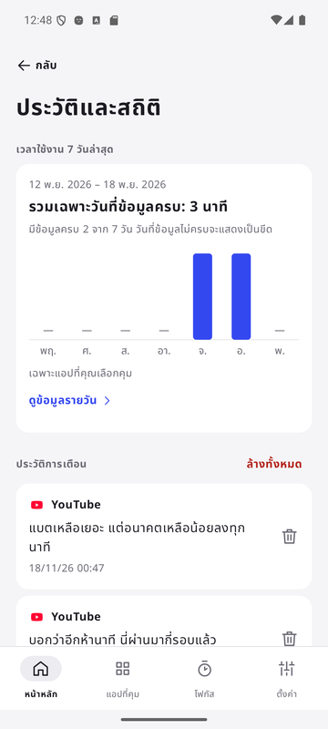
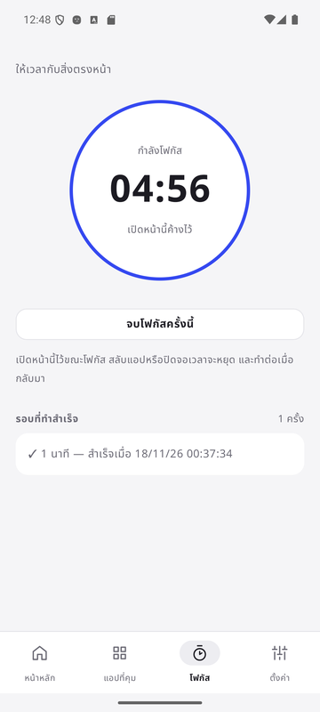

<div align="center">


# วางเดี๋ยวนี้! (Put It Down!)

**แอป Android ที่เตือนทันทีเมื่อคุณเล่นแอปเกินเวลาที่ตั้งไว้ ด้วยการแจ้งเตือน การสั่น และเสียงพากย์แซวให้วางมือถือ**

Term Project วิชา คพ.364 (CS364) การพัฒนาโปรแกรมประยุกต์สำหรับอุปกรณ์พกพา · ภาคเรียนที่ 1 ปีการศึกษา 2569 · มหาวิทยาลัยธรรมศาสตร์ ศูนย์รังสิต

</div>

<table>
  <tr>
    <td align="center"><br />หน้าหลัก</td>
    <td align="center"><br />แอปที่คุม</td>
    <td align="center"><br />การแจ้งเตือน</td>
    <td align="center"><br />ประวัติและสถิติ</td>
    <td align="center"><br />โหมดโฟกัส</td>
  </tr>
</table>

ผู้ใช้เลือกแอปที่มักเผลอใช้นาน เช่น YouTube แล้วตั้งเวลาต่อวันของแต่ละแอป เมื่อใช้ครบเวลา แอปจะเตือนทันทีและเตือนซ้ำตราบใดที่ยังเปิดแอปนั้นอยู่ ข้อมูลทั้งหมดอยู่ในเครื่อง แอปไม่ขอสิทธิ์อินเทอร์เน็ต

---

## ฟีเจอร์

| รหัส | ฟีเจอร์ | หน้าจอ |
|---|---|---|
| F1 | ขอสิทธิ์อ่านการใช้งานแอปและสิทธิ์แจ้งเตือนเมื่อเปิดแอปครั้งแรก | `OnboardingActivity` |
| F2–F3 | เลือกแอปที่ต้องการคุม ตั้งเวลาต่อวัน (พิมพ์เองหรือเลือก 15/30/60/120 นาที) แก้ไข และนำออก (ต้องยืนยันก่อน) | `TrackedAppsActivity` |
| F4 | ตรวจเวลาใช้งานจริงเบื้องหลังด้วย Foreground Service ทุก 30 วินาที (โหมดสาธิตทุก 5 วินาที) | `UsageTrackingService` |
| F5 | เตือนเมื่อใช้เกินเวลา: แจ้งเตือน + สั่น + เสียงพากย์ภาษาละ 8 ประโยค เตือนซ้ำทุก 5 นาที (โหมดสาธิตทุก 20 วินาที) | การแจ้งเตือนของระบบ |
| F6 | ประวัติการเตือนและกราฟเวลาใช้งาน 7 วัน ลบทีละรายการหรือล้างทั้งหมด (ต้องยืนยันก่อน) | `HistoryActivity` |
| F7 | โหมดโฟกัส: นับถอยหลัง หยุดเมื่อออกจากแอป นับต่อเมื่อกลับมา และบันทึกรอบที่สำเร็จ | `FocusActivity` |
| F8 | ตั้งค่าภาษาไทย/อังกฤษ ธีมสว่าง/มืด เปิดปิดเสียงพากย์ และโหมดสาธิต | `SettingsActivity` |
| F9 | ตัวอย่างการแจ้งเตือน: ดูหน้าตาและฟังเสียงพากย์ครบ 8 ประโยค | ตั้งค่า → ตัวอย่างการแจ้งเตือน |

นอกจากนี้

- กด Back ที่หน้าหลักครั้งแรกจะขึ้น Toast ต้องกดซ้ำภายใน 2 วินาทีจึงออกจากแอป ขณะจับเวลาโฟกัส กด Back แล้วมีหน้าต่างยืนยันก่อนออก
- ใช้ได้ทั้งแนวตั้งและแนวนอน บนแท็บเล็ตและมือถือแนวนอนแถบเมนูจะย้ายไปด้านข้าง
- เสียงเตือนเล่นผ่านช่องเสียงนาฬิกาปลุก แต่ไม่เล่นเมื่อเครื่องปิดเสียงหรือเปิดห้ามรบกวน

---

## เทคโนโลยีที่ใช้

| ส่วน | ที่ใช้ |
|---|---|
| ภาษาและหน้าจอ | Java 17, XML layout, AppCompat, Material Components 3, ConstraintLayout, RecyclerView |
| Build | Android Gradle Plugin 9.3.2, Gradle 9.5.0, compileSdk / targetSdk 35, minSdk 26 (Android 8.0) |
| ฐานข้อมูล | SQLite ผ่าน `SQLiteOpenHelper` (`core/AppDbHelper.java`) ใช้ `ContentValues` และเงื่อนไข `"=?"` ป้องกัน SQL Injection |
| ค่าตั้ง | `SharedPreferences` (ภาษา ธีม เสียงพากย์ โหมดสาธิต) |
| เวลาใช้งานแอป | `UsageStatsManager` (ต้องได้สิทธิ์ Usage Access) |
| งานเบื้องหลัง | Foreground Service ชนิด `specialUse`, `BroadcastReceiver` รับ `BOOT_COMPLETED` เพื่อเริ่มใหม่หลังเปิดเครื่อง |
| การเตือน | `NotificationCompat` + Notification Channel, `Vibrator`, `MediaPlayer` |
| สองภาษา / สองธีม | `values` + `values-th`, `values-night`, `AppCompatDelegate.setApplicationLocales()` |
| หลายขนาดจอ | `layout` (มือถือแนวตั้ง), `layout-land` (มือถือแนวนอน), `layout-sw600dp` (แท็บเล็ต) |

---

## ติดตั้งและรัน

### สิ่งที่ต้องมี

- Android Studio (ใช้ JDK ที่มากับโปรแกรม)
- มือถือหรือแท็บเล็ต Android 8.0 ขึ้นไป หรือ Emulator

### เปิดใน Android Studio

1. Clone repo นี้
2. Android Studio → **Open** → เลือกโฟลเดอร์ `cs364-roast-app`
3. รอ Gradle sync เสร็จ แล้วกด **Run**

### Build จาก command line

```bash
./gradlew assembleDebug
```

```bash
./gradlew installDebug
```

บน Windows ถ้าเครื่องไม่ได้ตั้ง `JAVA_HOME` ให้ชี้ไปที่ JDK ของ Android Studio ก่อน (Git Bash)

```bash
export JAVA_HOME="C:/Program Files/Android/Android Studio/jbr"
```

### เปิดแอปครั้งแรก

1. แอปจะเปิดหน้าขอสิทธิ์ กด **เปิดสิทธิ์** ทั้งสองอย่าง
   - **ดูเวลาใช้งานแอป** ระบบจะพาไปหน้า Usage Access ให้เปิดสวิตช์ของแอปนี้เอง (บนเครื่อง Xiaomi จะมีหน้าคำเตือนเพิ่มอีกชั้น ต้องรอนับถอยหลังแล้วกดตกลง)
   - **ส่งการแจ้งเตือน** กดอนุญาตในหน้าต่างของระบบ
2. กด **เข้าหน้าหลัก**

> ถ้าติดตั้งผ่านสาย USB บนเครื่อง Xiaomi ต้องเปิด **ตัวเลือกสำหรับนักพัฒนา → ติดตั้งผ่าน USB** ก่อน ไม่อย่างนั้นจะขึ้น `INSTALL_FAILED_USER_RESTRICTED`

### ลองให้แอปเตือนภายใน 2 นาที (สำหรับนำเสนอ)

1. ตั้งค่า → เปิด **โหมดสาธิต**
2. แอปที่คุม → **เลือกแอปที่ต้องการคุม** → เลือก YouTube → ตั้ง 1 นาที → **บันทึก**
3. เปิด YouTube ทิ้งไว้ เมื่อครบ 1 นาทีจะมีแจ้งเตือน สั่น และเสียงพากย์ แล้วเตือนซ้ำทุก 20 วินาที
4. กลับเข้าแอป → **ประวัติและสถิติ** จะเห็นรายการเตือนที่เพิ่งเกิด

---

## สิทธิ์ที่แอปขอ

| สิทธิ์ | ใช้ทำอะไร |
|---|---|
| `PACKAGE_USAGE_STATS` | อ่านว่าแอปไหนอยู่หน้าจอและใช้ไปนานเท่าไร (ผู้ใช้ต้องเปิดเองในหน้าตั้งค่าของระบบ) |
| `POST_NOTIFICATIONS` | แสดงการแจ้งเตือน (Android 13 ขึ้นไปต้องขอจากผู้ใช้) |
| `VIBRATE` | สั่นตอนเตือน |
| `FOREGROUND_SERVICE`, `FOREGROUND_SERVICE_SPECIAL_USE` | ตรวจเวลาใช้งานต่อเนื่องขณะผู้ใช้อยู่ในแอปอื่น |
| `RECEIVE_BOOT_COMPLETED` | เริ่มงานตรวจใหม่หลังเปิดเครื่อง |
| `QUERY_ALL_PACKAGES` | แสดงรายชื่อแอปที่ติดตั้งให้เลือกคุม |

---

## โครงสร้างโปรเจกต์

```text
app/src/main/
├── AndroidManifest.xml
├── java/com/cs364/roastapp/
│   ├── core/        หน้าหลัก ฐานข้อมูล (AppDbHelper) บริการกลาง หน้าต่างยืนยัน
│   ├── onboarding/  หน้าขอสิทธิ์
│   ├── tracking/    แอปที่คุม ตัวอ่านเวลาใช้งาน Foreground Service และ BootCompletedReceiver
│   ├── roast/       การแจ้งเตือน การสั่น และเสียงพากย์
│   ├── history/     ประวัติการเตือนและกราฟ 7 วัน
│   ├── focus/       โหมดโฟกัส
│   ├── settings/    ภาษา ธีม เสียงพากย์ โหมดสาธิต
│   └── ui/          แถบเมนู การ์ดแอป ตัวอย่างการแจ้งเตือน
└── res/
    ├── layout/ · layout-land/ · layout-sw600dp/
    ├── values/ (อังกฤษ) · values-th/ (ไทย) · values-night/ (ธีมมืด)
    └── raw/     เสียงพากย์ roast_th_01–08, roast_en_01–08
```

### ฐานข้อมูล `put_it_down.db`

| ตาราง | เก็บอะไร |
|---|---|
| `tracked_app` | แอปที่คุม (`packageName`) และเวลาต่อวัน (`limitMinutes`) |
| `focus_session` | รอบโฟกัสที่ทำสำเร็จ |
| `roast_event` | ประวัติการเตือน: แอป ข้อความ และเวลา |

---

## เอกสาร

| เอกสาร | เนื้อหา |
|---|---|
| [docs/report/CS364-report-v2.docx](docs/report/CS364-report-v2.docx) | รายงานฉบับเต็ม (Word) |
| [docs/navigation.md](docs/navigation.md) | แผนภาพหน้าจอและพฤติกรรมปุ่ม Back |
| [docs/detection.md](docs/detection.md) | ขั้นตอนการตรวจจับการใช้งานเกินเวลา |
| [docs/voice/README.md](docs/voice/README.md) | ที่มาและรายการไฟล์เสียงพากย์ |
| [docs/design/README.md](docs/design/README.md) | Design system สี ตัวอักษร และแบบหน้าจอ |
| [docs/design/FINAL-UI-CHECKLIST.md](docs/design/FINAL-UI-CHECKLIST.md) | รายการตรวจ UI และหลักฐาน |

---

## การทดสอบ

โปรเจกต์นี้ยังไม่มี automated test ทีมทดสอบด้วยมือตามกรณีทดสอบในบทที่ 5 ของรายงาน (TC-01 ถึง TC-16 และ T-01 ถึง T-08) บนอุปกรณ์ต่อไปนี้

| อุปกรณ์ | หน้าจอ | Android |
|---|---|---|
| Android Emulator (sdk_gphone64_x86_64) | 1080 × 2400 และปรับเป็น 720 × 1280, 1600 × 2560 | 15 (API 35) |
| Xiaomi Pad 8 Pro (แท็บเล็ตจริง) | 2136 × 3200 ทั้งแนวตั้งและแนวนอน | 16 (API 36) |

ภาพหลักฐานอยู่ใน [docs/report/img](docs/report/img) และ [docs/evidence](docs/evidence)

---

## ทีมผู้พัฒนา

ทีมแบ่งงานเป็น [GitHub issue](https://github.com/duckxy166/cs364-roast-app/issues) และส่งงานผ่าน [pull request](https://github.com/duckxy166/cs364-roast-app/pulls)

| สมาชิก | Issue | งานหลัก |
|---|---|---|
| [@duckxy166](https://github.com/duckxy166) | #1, #14, #15 | วางแผนและแบ่งงาน รวมงาน ทดสอบทั้งแอป และทำรายงาน |
| [@Suttipoch](https://github.com/Suttipoch) | #2, #11, #12, #16 | โครงแอปและการนำทาง โหมดโฟกัส หน้าตั้งค่า และพากย์เสียงคำเตือน 16 ประโยค |
| [@wuttikornboontawee](https://github.com/wuttikornboontawee) | #8, #9, #10, #17 | การแจ้งเตือน การสั่น การเล่นเสียงพากย์ และหน้าประวัติและสถิติ |
| [@Supavit-49](https://github.com/Supavit-49) | #5, #6, #7 | หน้าขอสิทธิ์ รายการแอปที่คุม และตัวตรวจจับการใช้งาน |
| [@dannypsx](https://github.com/dannypsx) | #3, #4, #13, #31 | Design system ออกแบบทุกหน้า ทำ UI ตามแบบ และตรวจคุณภาพ Android |

---

## แหล่งที่มาและการใช้ AI

- ฟอนต์ Noto Sans Thai (SIL Open Font License) และไอคอน Lucide (ISC)
- เสียงพากย์ทั้ง 16 ไฟล์ สมาชิกในทีมอัดเอง
- ทีมใช้ AI (Claude Code) ช่วยพัฒนาบางส่วน เช่น แปลงชั้นฐานข้อมูลจาก Room เป็น `SQLiteOpenHelper` ตามเนื้อหา MA10 ระบบเสียงพากย์ การรองรับแนวนอน และการทดสอบ รายละเอียดและวิธีตรวจสอบผลอยู่ในบทที่ 8 ของรายงาน

---

## ข้อจำกัดที่ทราบ

- แอปเตือนเท่านั้น ไม่ได้ปิดหรือล็อกแอปที่ใช้เกินเวลา
- ความแม่นยำของเวลาขึ้นกับรอบตรวจ (สูงสุด 30 วินาทีในโหมดปกติ)
- มือถือบางยี่ห้อที่ประหยัดแบตเตอรี่เข้มงวดอาจหยุด service ผู้ใช้ต้องยกเว้นแอปนี้จากการประหยัดแบตเตอรี่
- แอปที่เปิดค้างข้ามเที่ยงคืนโดยไม่มีเหตุการณ์ใหม่อาจยังไม่ถูกนับในวันใหม่
