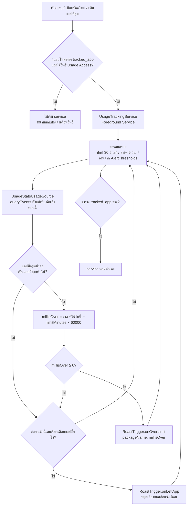

# ตัวตรวจจับการใช้งานเกินเวลา (F4)

เอกสารนี้อธิบายขั้นตอนการทำงานตั้งแต่อ่านข้อมูลการใช้งาน จนถึงส่งเรื่องให้ระบบเตือน

## ภาพรวม

## ขั้นตอนโดยละเอียด

1. **เริ่ม service** `TrackingServiceController.sync()` เรียกจาก `HomeActivity.onResume`, หลังเพิ่ม/ลบแอปที่คุม และจาก `BootCompletedReceiver` หลังเปิดเครื่อง
   - ไม่มีแอปที่คุม → หยุด service
   - มีแอปและได้สิทธิ์ Usage Access → เริ่ม `UsageTrackingService` (foreground, มี notification ถาวร)
2. **อ่านเวลาใช้งาน** `UsageStatsUsageSource` เล่นซ้ำ event ของวันนี้ (เที่ยงคืนตามเวลาเครื่อง)
   - `ACTIVITY_RESUMED` เริ่มนับ, `ACTIVITY_PAUSED` หยุดนับ (แยกตาม activity ของแต่ละแอป)
   - เมื่อจอดับ (`SCREEN_NON_INTERACTIVE`) ปิดช่วงที่ยังเปิดอยู่ทั้งหมด
   - ช่วงที่ยังเปิดอยู่ ณ ตอนนี้นับถึงเวลาปัจจุบัน และแอปนั้นคือ "แอปหน้าจอปัจจุบัน"
3. **เทียบกับเวลาที่ตั้ง** ดึงรายการจาก `tracked_app` (`packageName`, `limitMinutes`) เทียบเฉพาะแอปที่อยู่หน้าจอ
4. **เรียกระบบเตือน** ถ้าเกินหรือเท่ากับเวลาที่ตั้ง เรียก `RoastTrigger.onOverLimit(packageName, millisOver)` ระดับ 1–3 ตัดสินใน `RoastManager` (งาน F5)
5. **ออกจากแอป** เมื่อผู้ใช้ออกจากแอปที่เกินเวลา service เรียก `RoastTrigger.onLeftApp(packageName)` ครั้งเดียว แล้วไม่เรียก `onOverLimit` อีกจนกว่าจะกลับเข้าแอปนั้น
6. **ปิดหน้าแอปของเรา** service เป็น Foreground Service ทำงานบน thread ของตัวเอง ไม่ผูกกับ Activity จึงยังตรวจต่อเมื่อปิดหน้าแอป

## ไฟล์ที่เกี่ยวข้อง (`java/.../tracking/`)

| ไฟล์ | หน้าที่ |
|---|---|
| `UsageStatsUsageSource` | `UsageSource` ตัวจริง: เวลาใช้วันนี้ + แอปหน้าจอปัจจุบัน |
| `UsageTrackingService` | วนตรวจเป็นช่วง และเรียก `RoastTrigger` |
| `TrackingServiceController` | เริ่ม/หยุด service ให้ตรงกับรายการแอปและสิทธิ์ |
| `BootCompletedReceiver` | เริ่ม service ใหม่หลังเปิดเครื่อง |
| `PermissionChecker` | ตรวจสิทธิ์ Usage Access และการแจ้งเตือน |
| `TrackedAppEntity` / `TrackedAppDao` | ตาราง `tracked_app` |

## ข้อจำกัดที่ทราบ

- แอปที่เปิดค้างข้ามเที่ยงคืนโดยไม่มี event ใหม่ จะยังไม่ถูกตรวจว่าเป็นแอปหน้าจอจนกว่าจะมี event
- ความแม่นยำของเวลาขึ้นกับรอบตรวจ (สูงสุด 30 วินาทีในโหมดปกติ) และข้อมูลของ `UsageStatsManager`
- บางยี่ห้อ (เช่น ที่มีระบบประหยัดแบตเข้มงวด) อาจหยุด service ผู้ใช้ต้องยกเว้นแอปจากการจำกัดแบตเอง
