# หลักฐานตรวจคุณภาพ Android · 16 พฤศจิกายน 2026

ติดตามปัญหาใน [issue #31](https://github.com/duckxy166/cs364-roast-app/issues/31) · [รายงานภาษาไทยฉบับเต็ม](report-th.md)

รุ่นที่ตรวจ: `39e42cc` ซึ่งรวมเข้า main ผ่าน PR #30 แล้ว คะแนน 14/20 พบ P1 จำนวน 1 ข้อ และ P2 จำนวน 4 ข้อ

ชุดนี้มีรายงาน ภาพ Android 12 ภาพ และหลักฐานเฉพาะจุด ไม่มีการแก้ไฟล์แอป การรวมหลักฐานเข้า main **ไม่ปิด issue และไม่ใช่การแก้ปัญหา**

| หลักฐาน | ใช้ยืนยันอะไร |
|---|---|
| [ลำดับ Activity](evidence/back-stack.txt) | Home → Settings → Home → Back แล้วกลับ Settings |
| [ขนาดพื้นที่กด](evidence/touch-targets.json) | preset 74×48dp และแท็บ 90×80dp ในกรณีที่วัด |

ภาพต่อไปนี้เป็นภาพหน้าจอ Android จริง ภาพประวัติที่ใช้ข้อมูลตัวอย่างระบุไว้ในคำบรรยาย ไม่มีผลวัด FPS บนโทรศัพท์จริงหรือการรับรอง TalkBack ด้วยการฟังจริงในชุดนี้

## พบปัญหา: ช่องกรอกเวลาโฟกัส ฟอนต์ 200%

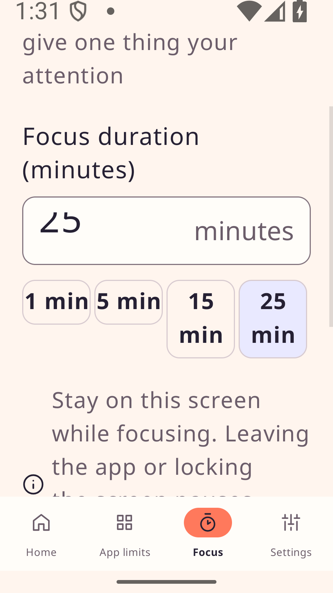

## พบปัญหา: หน้าโฟกัสก่อนเลื่อน ฟอนต์ 200%

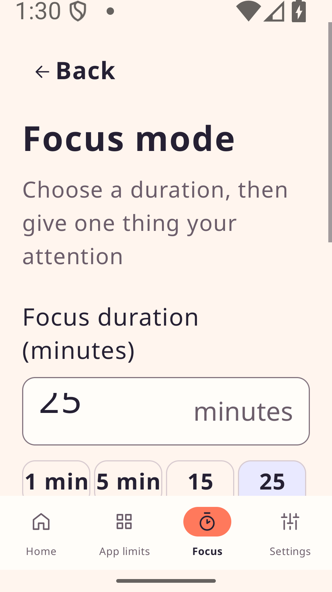

## เปรียบเทียบ: โฟกัสฟอนต์ 130%

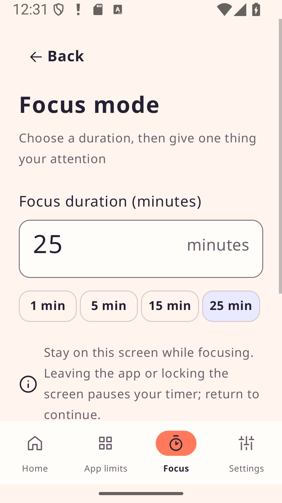

## กรณีที่ผ่าน: ปุ่มบันทึกอยู่เหนือคีย์บอร์ด

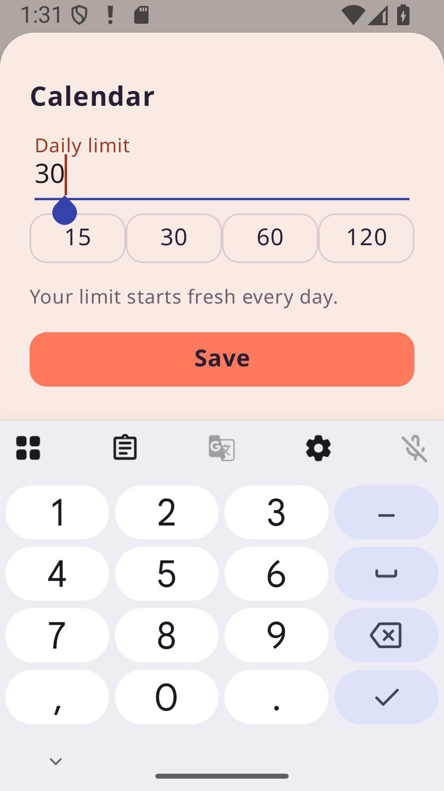

## หน้าหลักที่อนุมัติ · สว่าง

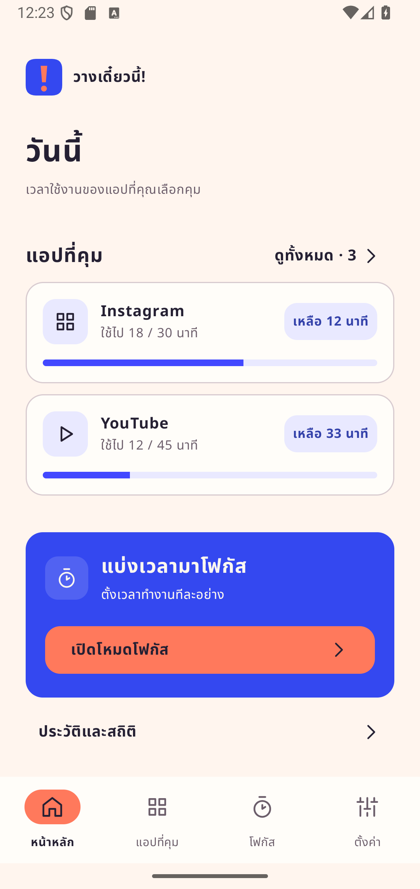

## หน้าหลักที่อนุมัติ · มืด

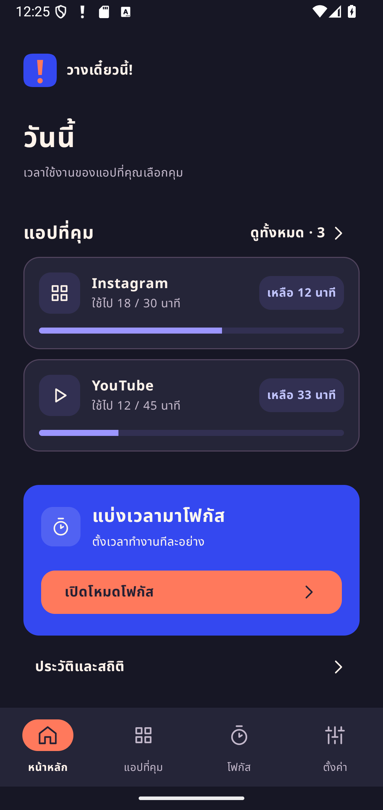

## ตั้งค่า · สว่าง

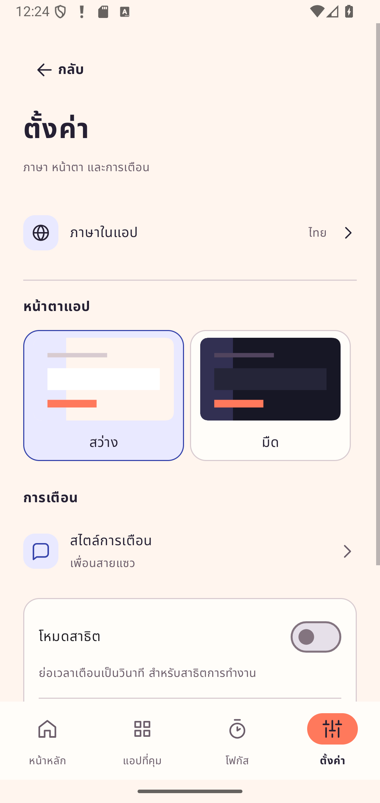

## ตั้งค่า · มืด

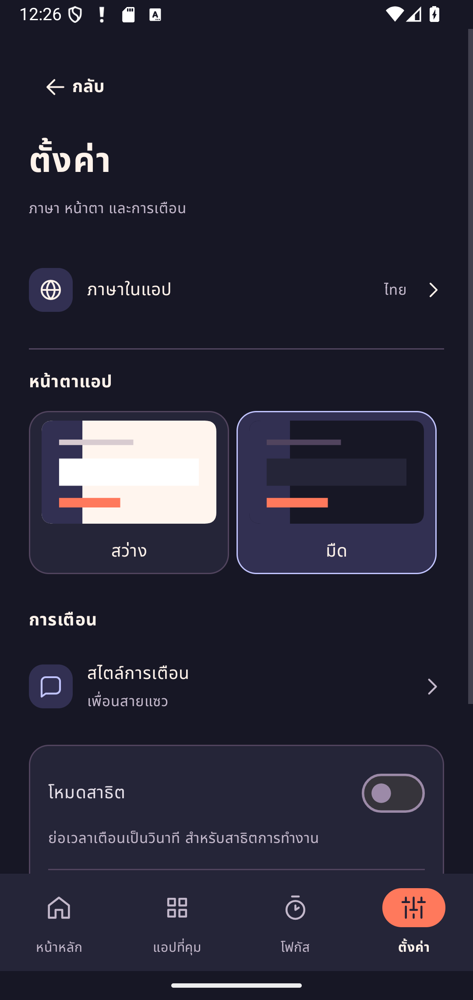

## ประวัติ · สว่าง ข้อมูลตัวอย่างเฉพาะ debug

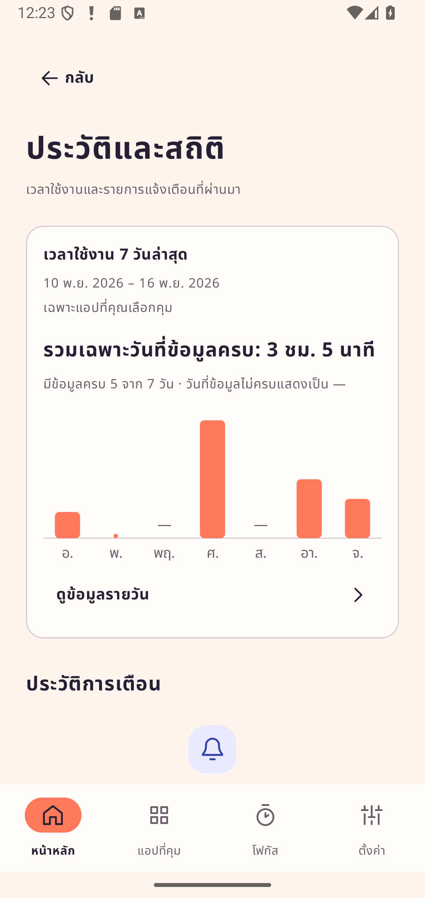

## ประวัติ · มืด ข้อมูลตัวอย่างเฉพาะ debug

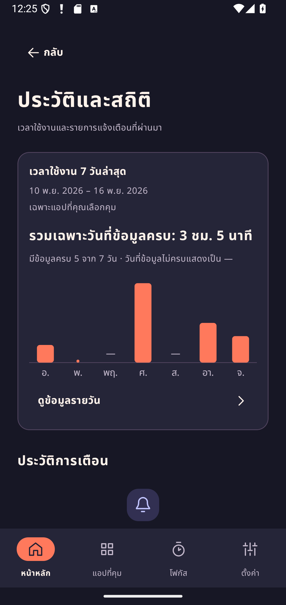

## หน้าหลักบนแท็บเล็ต · สว่าง

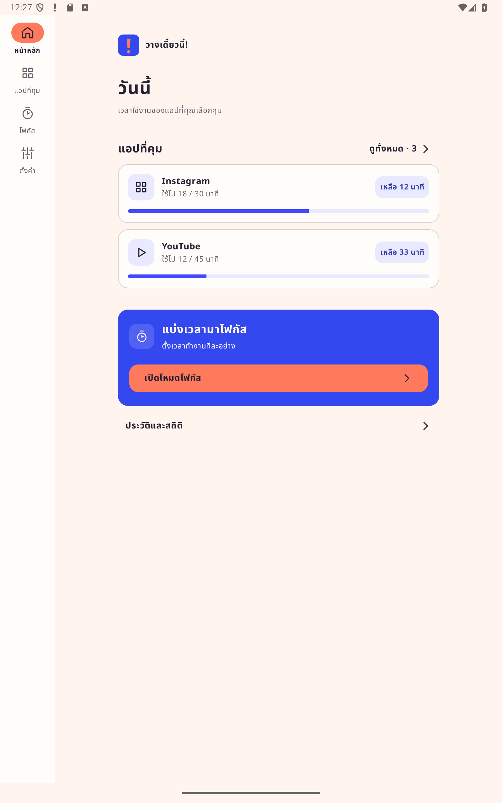

## หน้าหลักบนแท็บเล็ต · มืด

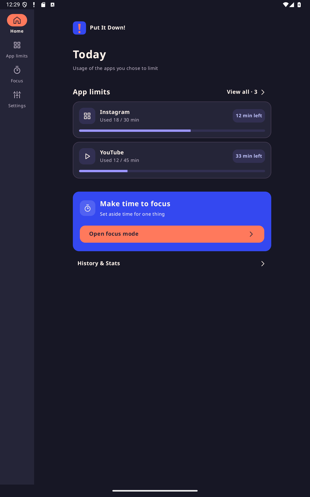
