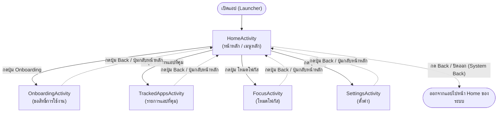

# แผนภาพเส้นทางหน้าจอและการกดปุ่ม Back (Navigation & Back Stack)

เอกสารนี้อธิบายโครงสร้างหน้าจอของแอป **วางเดี๋ยวนี้ (Put It Down)** และเส้นทางการเปลี่ยนหน้าจอ รวมถึงพฤติกรรมการกดปุ่ม Back ตามข้อกำหนดใน Issue #2 (Rubric 4.1, 4.2)

## 1. รายชื่อหน้าจอและไฟล์ที่เกี่ยวข้อง

| หน้าจอ | Activity | Package | Layout |
|---|---|---|---|
| หน้าหลัก (เมนู) | `HomeActivity` | `com.cs364.roastapp.core` | `res/layout/core_activity_home.xml` |
| ขอสิทธิ์การใช้งาน (Onboarding) | `OnboardingActivity` | `com.cs364.roastapp.onboarding` | `res/layout/onboarding_activity.xml` |
| รายการแอปที่คุม | `TrackedAppsActivity` | `com.cs364.roastapp.tracking` | `res/layout/tracking_activity.xml` |
| โหมดโฟกัส | `FocusActivity` | `com.cs364.roastapp.focus` | `res/layout/focus_activity.xml` |
| ตั้งค่า | `SettingsActivity` | `com.cs364.roastapp.settings` | `res/layout/settings_activity.xml` |

---

## 2. แผนภาพเส้นทางหน้าจอและปุ่ม Back (Screen Flow & Back Navigation)

---

## 3. พฤติกรรมการกดปุ่ม Back (Back Navigation Rules)

1. **จากหน้าฟีเจอร์ทุกหน้า (`OnboardingActivity`, `TrackedAppsActivity`, `FocusActivity`, `SettingsActivity`)**:
   - เมื่อเปิดจาก `HomeActivity` แล้วกดปุ่ม Back ของระบบ หรือปุ่ม "กลับหน้าหลัก" (`btn_*_back`) บนหน้าจอ จะปิด Activity ปัจจุบันและย้อนกลับมาที่ `HomeActivity` เสมอ
   - ใน `AndroidManifest.xml` กำหนด `android:parentActivityName=".core.HomeActivity"` และตั้ง `launchMode="singleTop"` ที่ `HomeActivity` เพื่อไม่ให้สร้างหน้าหลักซ้ำซ้อนใน Back Stack
   - สำหรับหน้า `FocusActivity` (Issue #11): ขณะจับเวลาโฟกัส การกด Back จะแสดง `ConfirmDialog` เพื่อถามยืนยันก่อนออกจากโหมดโฟกัส

2. **ที่หน้าหลัก (`HomeActivity`)**:
   - เมื่อกดปุ่ม Back หรือปัดออกจากขอบจอ (System Back Gesture) ระบบ Android จะออกจากแอปกลับสู่หน้าโฮมของเครื่องตามมาตรฐานระบบทันที
